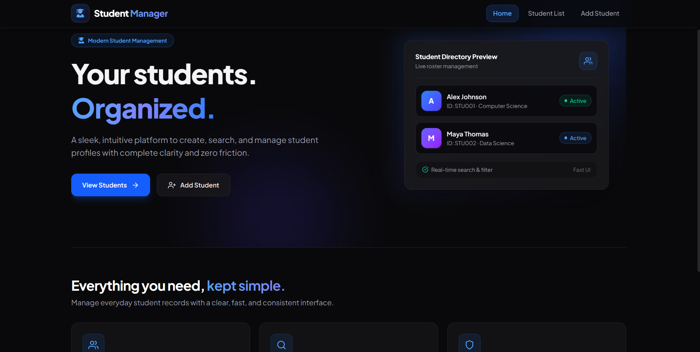
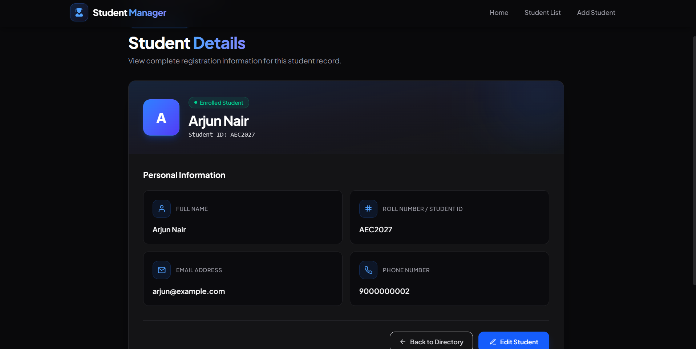
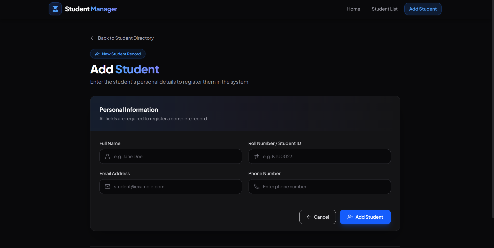

# Student Management System

A clean and intuitive React application for managing student records, tracking personal details, and searching through student directories with browser-based local storage persistence.

---

## How It Works

The application operates as a single-page application (SPA) built with React and React Router:

1. **Local Data Persistence**: Student data is stored in the browser's `localStorage`. Whenever you add, update, or delete a student, the list updates in React state and syncs automatically with `localStorage` so your data remains intact across page reloads.
2. **Duplicate Check on Add**: When submitting the student form, the system checks if the entered Student ID already exists in the records to avoid duplicate entries.
3. **Instant Search & Filtering**: The Student Directory page includes a real-time name filter powered by React's `useMemo`, instantly narrowing down records as you type without making server requests.
4. **Full Record Details & Editing**: Each student has a dedicated profile view showcasing all submitted details (Full Name, Roll Number / Student ID, Email, and Phone Number). From there, you can jump straight into the edit screen to modify fields with confirmation safeguards.
5. **Safe Deletion**: Removing a student requires a confirmation prompt to prevent accidental data loss.

---

## Features

- **Student Directory**: Browse all enrolled students presented in clean, responsive cards.
- **Real-Time Name Search**: Quickly find students by name with dynamic filtering and a one-click search reset.
- **Add New Students**: Form with input validation for full name, student ID / roll number, email address, and phone number.
- **Detailed Student Profiles**: Dedicated view displaying all recorded information for an individual student.
- **Edit Existing Records**: Pre-filled update form to modify student details safely.
- **Persistent Storage**: All actions save immediately to `localStorage` without requiring a backend database.
- **Mobile-Responsive Design**: Fully responsive layout with mobile drawer navigation, adaptable card grids, and touch-friendly controls.

---

## Screenshots

> *Add screenshots of the app below or place images in the `screenshots/` directory.*

### Home Page


### Student Directory & Search


### Student Profile Details


### Add / Edit Student Form


---

## Tech Stack

- **Frontend Framework**: [React 19](https://react.dev/)
- **Build Tool**: [Vite](https://vite.dev/)
- **Styling**: [Tailwind CSS v4](https://tailwindcss.com/)
- **Routing**: [React Router v7](https://reactrouter.com/)
- **Icons**: [React Icons](https://react-icons.github.io/react-icons/) (Feather Icons, FontAwesome, Material Icons)

> **Note on AI Usage**:
> Artificial Intelligence (AI) was utilized strictly for **UI styling refinements, Tailwind CSS consistency, and documentation**. The core application logic, component architecture, state management, and functional features were independently written and developed.

---

## Getting Started

### Prerequisites
Make sure you have [Node.js](https://nodejs.org/) (version 18 or newer recommended) installed.

### Installation

1. Clone the repository:
   ```bash
   git clone https://github.com/adhithyan-h-nair/student-management-app.git
   ```

2. Navigate into the project folder:
   ```bash
   cd student-management-system
   ```

3. Install dependencies:
   ```bash
   npm install
   ```

4. Start the development server:
   ```bash
   npm run dev
   ```

5. Open your browser and navigate to `http://localhost:5173`.

### Production Build

To create an optimized production build:
```bash
npm run build
```

To preview the production build locally:
```bash
npm run preview
```

---

## License

This project was built for educational and practice purposes. Feel free to use and adapt it as needed.
